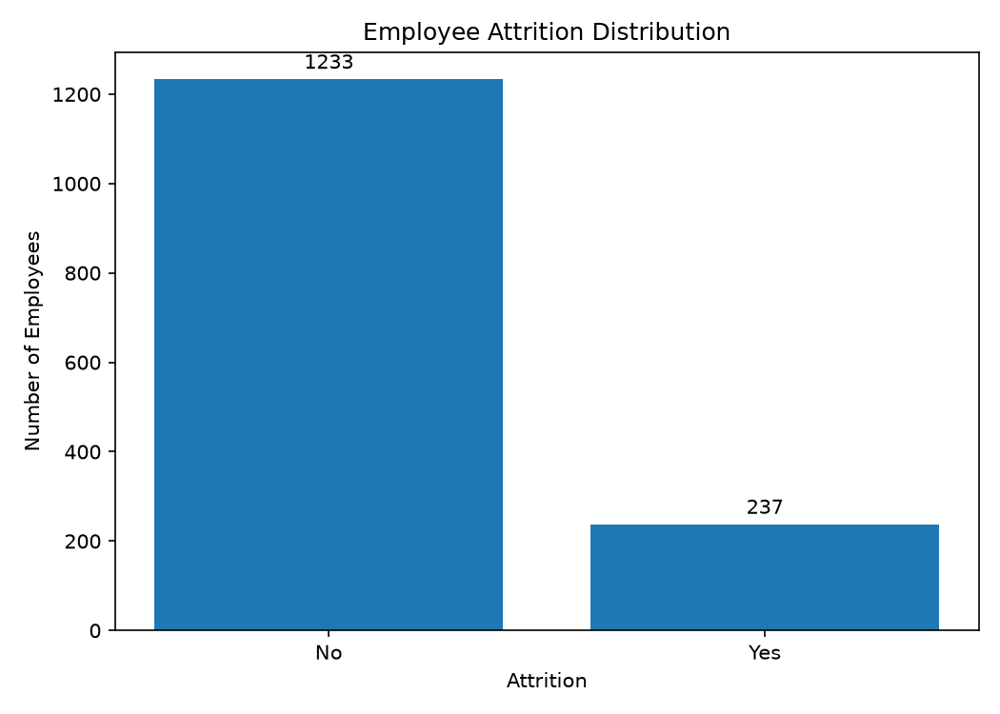
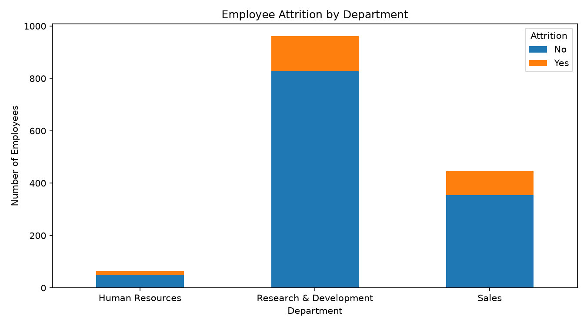
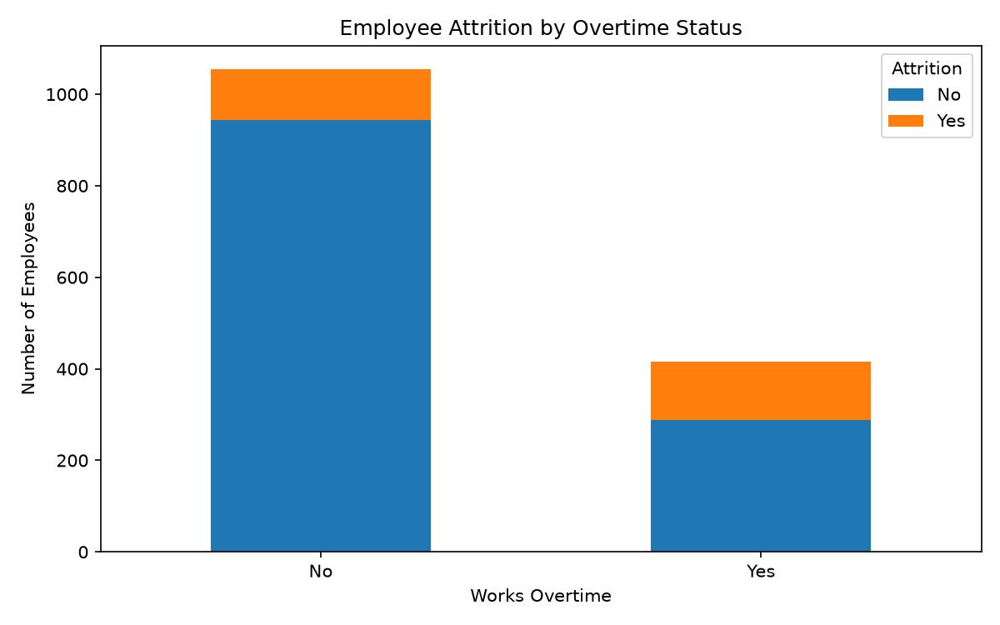
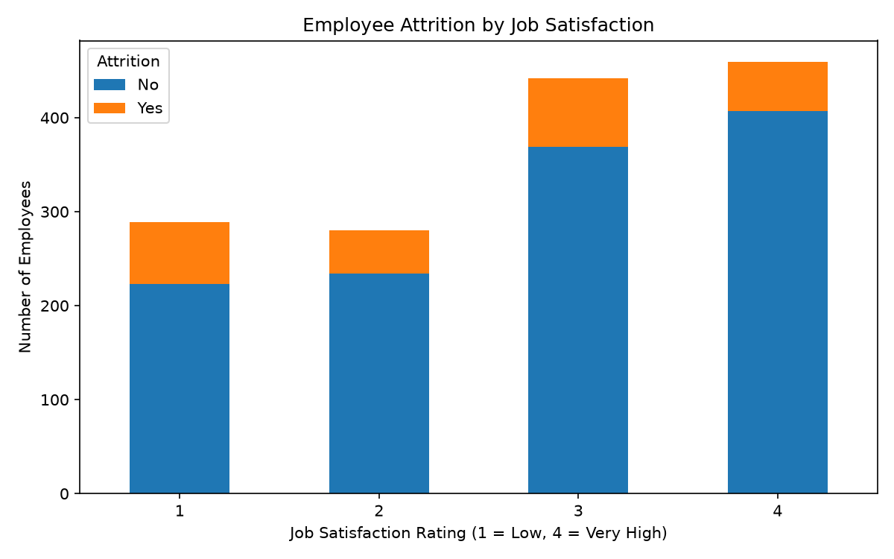
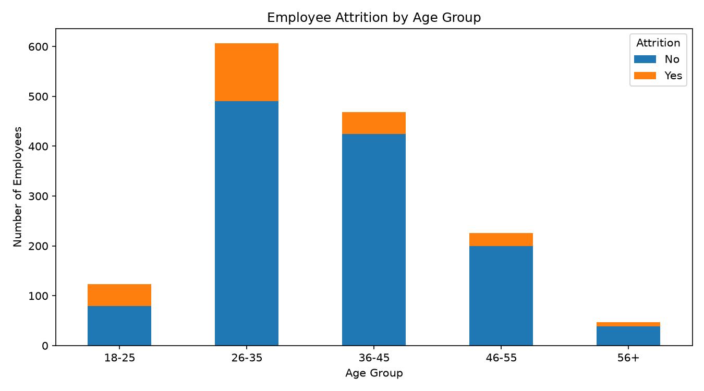

# Exploratory Data Analysis (EDA) Report

## AI-Based Employee Attrition Prediction System

### 1. Project Overview

This report documents the exploratory data analysis performed on the IBM HR Analytics Employee Attrition dataset. The purpose of this stage is to inspect the data, check its quality, explore employee attrition patterns, and create visualizations.

Predictive model training and evaluation are outside the scope of this EDA stage.

### 2. Dataset Overview

- **Total records:** 1,470
- **Original columns:** 35
- **Missing values:** 0
- **Duplicate rows:** 0

The dataset contains employee information such as age, department, job satisfaction, overtime status, years of experience, and attrition status.

### 3. Overall Attrition Distribution

- Employees who stayed: 1,233 (83.88%)
- Employees who left: 237 (16.12%)

The dataset contains more employees labeled as having stayed than employees labeled as having left.

### 4. Department vs. Attrition

| Department             | Stayed | Left | Attrition percentage |
| ---------------------- | -----: | ---: | -------------------: |
| Human Resources        |     51 |   12 |               19.05% |
| Research & Development |    828 |  133 |               13.84% |
| Sales                  |    354 |   92 |               20.63% |

Sales has the highest observed attrition percentage among the three departments, while Research & Development has the lowest.

### 5. Overtime vs. Attrition

| Overtime status | Stayed | Left | Attrition percentage |
| --------------- | -----: | ---: | -------------------: |
| No              |    944 |  110 |               10.44% |
| Yes             |    289 |  127 |               30.53% |

The observed attrition percentage is higher among employees who work overtime than among employees who do not.

### 6. Job Satisfaction vs. Attrition

| Job satisfaction rating | Stayed | Left | Attrition percentage |
| ----------------------- | -----: | ---: | -------------------: |
| 1                       |    223 |   66 |               22.84% |
| 2                       |    234 |   46 |               16.43% |
| 3                       |    369 |   73 |               16.52% |
| 4                       |    407 |   52 |               11.33% |

Rating 1 has the highest observed attrition percentage, while rating 4 has the lowest. The ratings are treated as the dataset's numeric satisfaction categories.

### 7. Age Group vs. Attrition

| Age group | Stayed | Left | Attrition percentage |
| --------- | -----: | ---: | -------------------: |
| 18–25     |     79 |   44 |               35.77% |
| 26–35     |    490 |  116 |               19.14% |
| 36–45     |    425 |   43 |                9.19% |
| 46–55     |    200 |   26 |               11.50% |
| 56+       |     39 |    8 |               17.02% |

The 18–25 age group has the highest observed attrition percentage, while the 36–45 group has the lowest. The 56+ group has fewer records, so its percentage should be interpreted with its smaller group size in mind.

### 8. Data Quality Summary

The initial checks found no missing values and no exact duplicate rows. The dataset contains 1,470 records and 35 original columns.

### 9. Conclusion

The exploratory analysis identified differences in observed attrition percentages across departments, overtime status, job satisfaction ratings, and age groups. These findings describe patterns in this dataset and do not establish that any individual factor causes attrition.

### 10. Limitations and Next Steps

This stage is descriptive and does not include a trained or evaluated prediction model. Potential next steps include preparing features, splitting data into training and test sets, training classification models, and evaluating them using appropriate metrics.

All findings in this report are based on the outputs generated during the current EDA stage.
